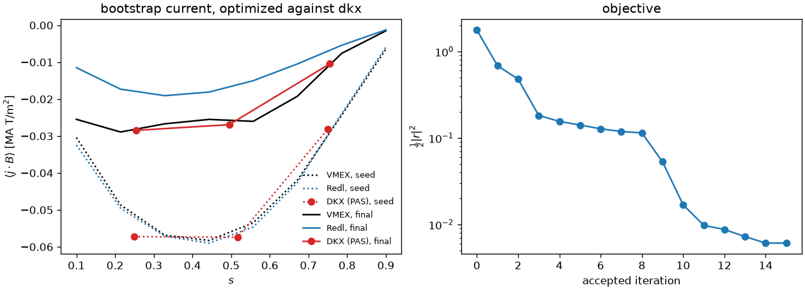

# Advanced examples

Research-scale scripts that build on the tutorials (`../tutorials/`). Both
need the optional `vmex` and `booz_xform_jax >= 0.4` packages and run for tens
of minutes on a CPU. Like the tutorials they are flat scripts: the input
parameters are plain variables at the top, one comment each, and nothing is
read from the command line or the environment.

| Script | What it does | Runtime |
| --- | --- | --- |
| [`QA_optimization_bootstrap_dkx.py`](QA_optimization_bootstrap_dkx.py) | VMEX's QA bootstrap-current optimization with the Redl row replaced by the drift-kinetic one DKX computes on each trial equilibrium | 30 min, 4.6 GB, four CPU threads |
| [`ambipolar_bootstrap_dkx.py`](ambipolar_bootstrap_dkx.py) | the same traced row at the ambipolar `E_r` of a rotating-ellipse equilibrium, with its implicit Jacobian checked against central differences | tens of minutes |

## The kinetic bootstrap row

The row is traced (boundary -> VMEX -> `booz_xform_jax` -> DKX), so VMEX's
implicit Jacobian carries it. Adding it to any other `vmex` optimization
script is one import and one tuple:

```python
from dkx.bootstrap import KineticBootstrapMismatch

kinetic = KineticBootstrapMismatch(profiles, surfaces=[0.25, 0.5, 0.75])
objective_function_terms.append((kinetic, 0.0, 1.0))
```

`profiles` is the same `vmex.core.bootstrap.KineticProfiles` the Redl term
takes, so both models describe one plasma, and the residual is Redl's
normalized mismatch, so the weights compare. The default collision operator
is pitch-angle scattering, which has no momentum restoration and overestimates
`<j.B>`; `collision_operator=0` is Fokker-Planck.

At the committed parameters (three kinetic surfaces, `11 x 11 x 16 x 4`,
modes 1 then 2, ten evaluations each) one run took 30 minutes: objective
1.78 -> 0.0061, quasisymmetry 6.7e-2 -> 5.7e-3, and the DKX mismatch `f_boot`
1.2e-3 -> 1.2e-4 on the `ns = 101` re-solve. The optimized equilibrium carries
the pitch-angle-scattering current, 1.5-1.6 times Redl's at `s = 0.25-0.75`:
the operator's known excess, not a physical difference.



## Moved or removed

The finite-beta VMEC-to-kinetic-profiles driver and the proxy-objective and
promotion-audit scripts for completed `dkx scan-er` runs take command-line
arguments, so they now live in `tools/optimization/`. The `optimize_` family of
shape-optimization scripts, their shared objectives module and the QH and QI pairings were
removed; tutorials 14 and 15 cover the gradient workflow, and the old scripts
are in the git history.
